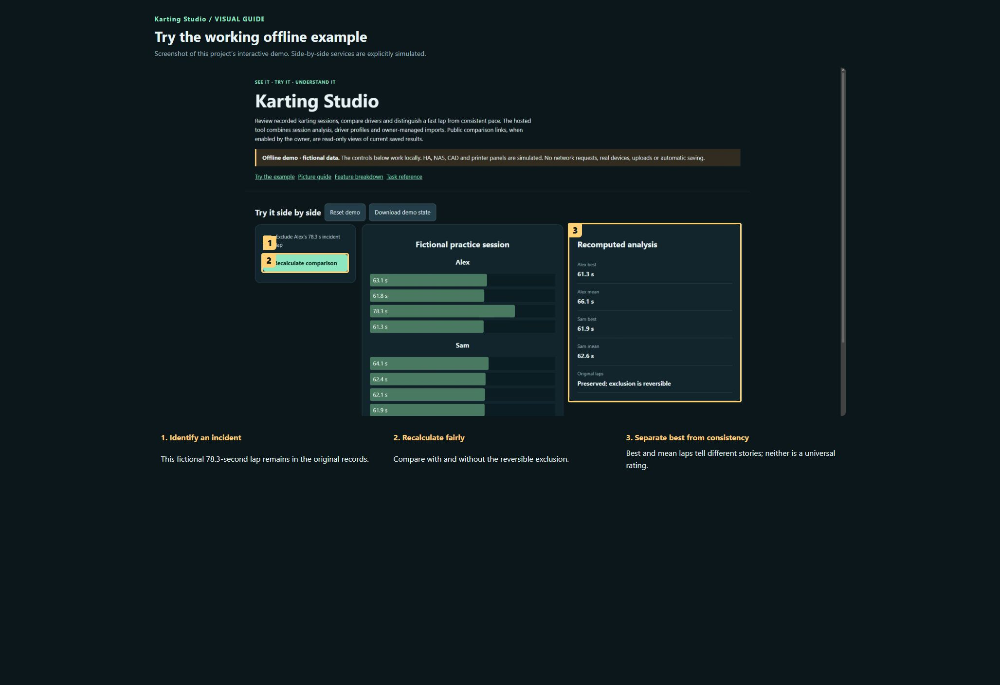

# Karting Studio

**Maintaining this project? [Start here](docs/START-HERE.md) · [Detailed handover](docs/HANDOVER.md)**

Review recorded karting sessions, compare drivers and distinguish a fast lap from consistent pace. The hosted tool combines session analysis, driver profiles and owner-managed imports. Public comparison links, when enabled by the owner, are read-only views of current saved results.

**Private preview · not published.**

[Open the visual manual](docs/USER-MANUAL.md) · [Download the self-contained demo](demo.html) · [Release notes](CHANGELOG.md)

Download `demo.html` using GitHub’s Download raw file control, then open it in your browser. GitHub displays HTML source; it does not run the demo on this page. The demo is an offline simulation with fictional data and makes no network requests.

## See it

### Try the working offline example

Screenshot of this project’s interactive demo. Side-by-side services are explicitly simulated.

1. **Identify an incident.** This fictional 78.3-second lap remains in the original records.
2. **Recalculate fairly.** Compare with and without the reversible exclusion.
3. **Separate best from consistency.** Best and mean laps tell different stories; neither is a universal rating.

## What this tool does

| Feature | What it lets you do | Where |
| --- | --- | --- |
| Session selection | Choose venue/session and inspect a leaderboard and lap history. | Hosted analysis |
| Driver comparison | Compare two drivers, lap charts, median pace, consistency and available summary metrics. | Hosted analysis |
| Incident handling | Exclude an incident lap with a reason and restore it later; retain the original record. | Hosted analysis |
| Driver directory | Track repeated drivers, aliases and profile decisions; owner tools merge/unmerge identities. | Hosted analysis |
| Ratings | Choose the disclosed Peak speed or Balanced driving comparison convention. | Hosted analysis |
| Imports and sharing | Preview workbook imports and share supported read-only driver comparisons. | Hosted analysis |

## A first useful workflow

### Compare two drivers

1. Choose the venue and session first so both drivers are being compared in the intended context. Select two driver profiles.
2. Read the best lap alongside median pace and consistency; a single best lap does not describe an entire session.
3. Inspect the lap plot and lap-1 choice. A summary-only source may not support a full lap-by-lap chart.

## Saving and outputs

The NAS stores imported timing records, identity decisions, notes and exclusions. Source archives are separate from Git source. Public links expose their permitted comparison, so choose sharing deliberately.

## Running the actual tool

Use the configured Projects gateway; demo.html is an independent fictional session.

The demo has no prerequisites; the real tool may need the services described in the manual and retained source notes.

## Current boundaries

Stars are a disclosed relative scoring convention, not an independent assessment of driving ability. This repository contains app/host modules and needs the shared gateway to run as hosted software. The demo uses fictional drivers.

## Licence and sharing

MIT applies to original project contributions. Bundled/upstream software and assets retain their own terms; see [third-party notes](THIRD-PARTY.md). Keep this repository private until its own [release checklist](RELEASE-CHECKLIST.md) is complete and the owner authorises publication.
